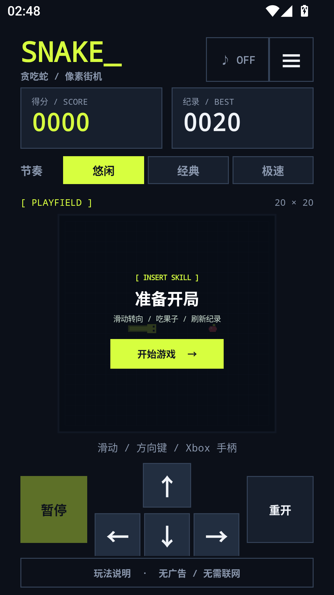
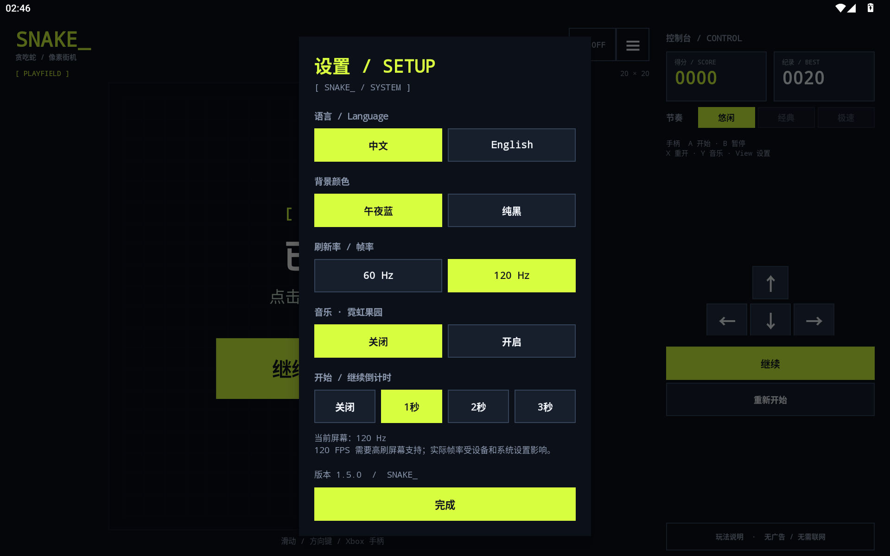
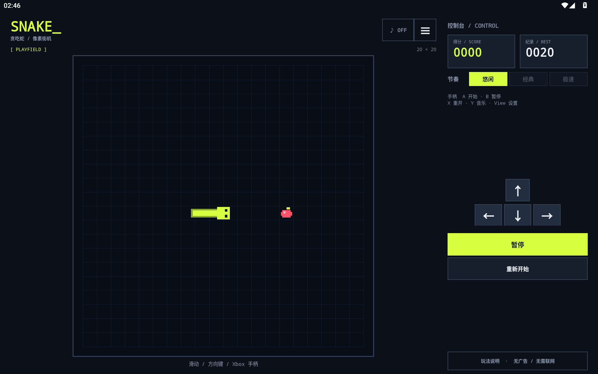

# 贪吃蛇 · SNAKE_

[English documentation](README.en.md)

一个原生 Android 单机小游戏。像素街机风格，深色底、荧光黄像素蛇与红色果实，无广告、无账号、不申请网络或存储权限。无需游戏引擎、WebView 或第三方运行库。

[下载 Android 安装包](dist/snake-offline-v1.5.0.apk?raw=true) · [查看验证记录](dist/验证记录.txt)




## 安装

安装文件：`dist/snake-offline-v1.5.0.apk`。已安装旧版时可直接覆盖安装，保留本地纪录。

把 APK 传到 Android 手机，使用文件管理器打开并安装。如果系统提示，请为打开此文件的应用允许“安装未知应用”。支持 Android 6.0 及以上；APK 使用本地专用密钥签名，可直接安装。

## 平板与音乐

- 支持16:10平板横屏；左侧为正方形棋盘，右侧为得分、难度和操作区，棋盘不会被拉伸。
- 平板可横竖屏切换，旋转后保留本局得分并暂停；手机保留竖屏布局。
- 原创8-bit循环曲《霓虹果园 / Neon Orchard》：128 BPM、60秒，脉冲波旋律、低音、分解和弦与合成鼓组。
- 游戏开始时播放，暂停、结束、打开设置或切后台时停止；设置里可关闭音乐，选择会保存。
- [下载音乐 WAV](dist/neon-orchard.wav) · [查看作曲说明](music/README.md)



## 操作

- 开局蛇身为3格。点击“开始游戏”，默认1秒后开始；设置中可选关闭、1秒、2秒、3秒倒计时。
- 方向按钮按下即提交方向，滑动达到 3dp 即可识别，并过滤微小抖动和重复方向；电脑模拟器也支持方向键 / WASD。
- 转向在最近的格点执行；输入后当前格段的剩余路程会在最多 32ms 的计时预算内完成（实际显示还受帧回调影响），转弯时短暂加速，随后恢复原速度。开局即开始平滑移动；到达食物后才计分，支持修正尚未执行的转向。
- 每颗果子加 10 分并增长一格，撞到墙或身体结束游戏；不能直接反向掉头。
- 悠闲 / 经典 / 极速分别为 220 / 150 / 100 毫秒一步，各自保存最高分。
- 画面跟随屏幕刷新，蛇在格子间平滑移动；三档移动速度独立于渲染帧率。
- 点击“暂停”或按空格暂停，点击“继续”恢复。切到后台、打开玩法说明时自动暂停。
- “重新开始”会在当前游戏尚未结束时询问确认。切换速度需先回到开局界面。
- 填满 20 × 20 棋盘即获胜。

## Xbox / 微软手柄

适配Android识别的标准手柄输入：十字键、左摇杆转向；A开始/继续，B暂停，Menu开始/暂停，X重开，Y切换音乐，View打开设置。左摇杆带死区与斜向抖动过滤，持续推住不会重复塞入转向指令；活动手柄断开时暂停游戏。

已验证模拟器注入的手柄按键事件及111项输入算法断言，尚未实测实体Xbox手柄的蓝牙/USB连接。手机方向键已居中，平板方向键居中放置于右侧控制区。

## 设置

点击右上角菜单按钮打开设置，游戏会自动暂停。

- **语言**：中文 / English，覆盖游戏文字、提示和设置。
- **背景**：午夜蓝 / 纯黑，包括主界面和设置面板。
- **刷新率 / 帧率**：60 Hz / 120 Hz，同时设置绘制上限并向系统请求对应的显示模式。120 FPS 需要设备支持；不支持时按可用刷新率运行，面板显示当前屏幕 Hz。
- **音乐**：开启 / 关闭原创循环背景音乐；主界面 ♪ ON/OFF 或手柄 Y 也可切换，设置会保存。
- **倒计时**：开始/继续前等待0–3秒，默认1秒；关闭时立即开始。
- **版本号**：在设置底部显示当前安装版本。

设置即时生效并在重启后保留。更改设置会保留本局得分与暂停状态。实际渲染帧率受设备性能、省电模式和系统策略影响。

## 源码与构建

- `app/src/main/java/com/mintarcade/snake/SnakeGame.java`：与 Android 无关的游戏规则。
- `app/src/main/java/com/mintarcade/snake/MainActivity.java`：原生界面、绘制、触屏控制、生命周期和纪录保存。
- `FrameClock.java` / `FramePacer.java` / `SnakeMotion.java` / `SwipeTracker.java`：固定步长计时、60/120 FPS 绘制上限、暂停恢复与向前绘制的平滑移动。
- `tests/com/mintarcade/snake/SnakeGameTest.java`：移动、输入缓冲、碰撞、计分、恢复、通关及随机游戏测试。
- `tests/com/mintarcade/snake/RenderingTest.java`：30–144 Hz 下的速度一致性、暂停计时、卡顿恢复、转角和增长动画。
- `tests/com/mintarcade/snake/InputResponseTest.java`：方向修正、连续转向、开局动画时序、到达判定和墙边转向。
- `build.ps1`：测试、资源编译、Java 编译、DEX 转换、打包、对齐、签名与校验。
- `setup-tools.ps1`：下载固定版本的官方工具并校验哈希。

在项目目录执行：

```powershell
# 首次构建：下载并校验构建工具
powershell -NoProfile -ExecutionPolicy Bypass -File .\setup-tools.ps1

# 编译、测试并生成签名 APK
powershell -NoProfile -ExecutionPolicy Bypass -File .\build.ps1
```

工具链使用 Java 17、Android Platform 35 和 Build Tools 35.0.0。首次准备工具需要联网，之后构建和游戏均不需要联网。无需安装 Android Studio 或 Gradle。

本地签名密钥和随机密码保存在 `.signing/`，已从版本管理排除。请私下备份整个目录；以后升级同一应用需保留相同签名。不要分发这个目录或把它提交到仓库。APK 和源码可以单独分发。

## 验证

构建脚本执行 34,729 项规则断言、531 项渲染/计时断言、326 项输入断言与 111 项手柄输入断言，并验证 APK 的 v1 / v2 / v3 签名和 ZIP 对齐。已在本机 Android 15 MuMu 模拟器成功覆盖安装、启动和操作。

v1.3.0 已在 Android 15 MuMu 模拟器覆盖安装并检查像素街机主界面、中英文设置和纯黑背景。12px（当前密度下为 3dp）的短滑动可触发转向。120Hz 模式下取得约 0.70 秒、85 个绘制帧的短样本，系统报告 0 卡顿帧；短样本不代表持续性能，也不是触摸到画面的端到端延迟测量。尚未在高刷手机上实测。

`dist/SHA256SUMS.txt` 保存最终 APK 的 SHA-256 校验值。

本轮 v1.4.0 已验证1920×1200横屏、1200×1920竖屏、切换后得分保留，以及音乐播放/关闭/暂停/后台停止。音频在独立播放器中异步准备，游戏绘制回调不负责合成音乐。
